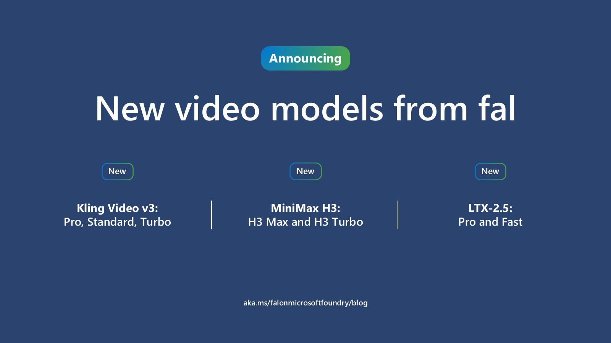
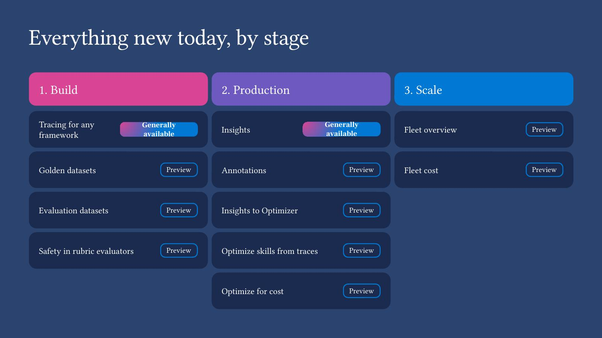
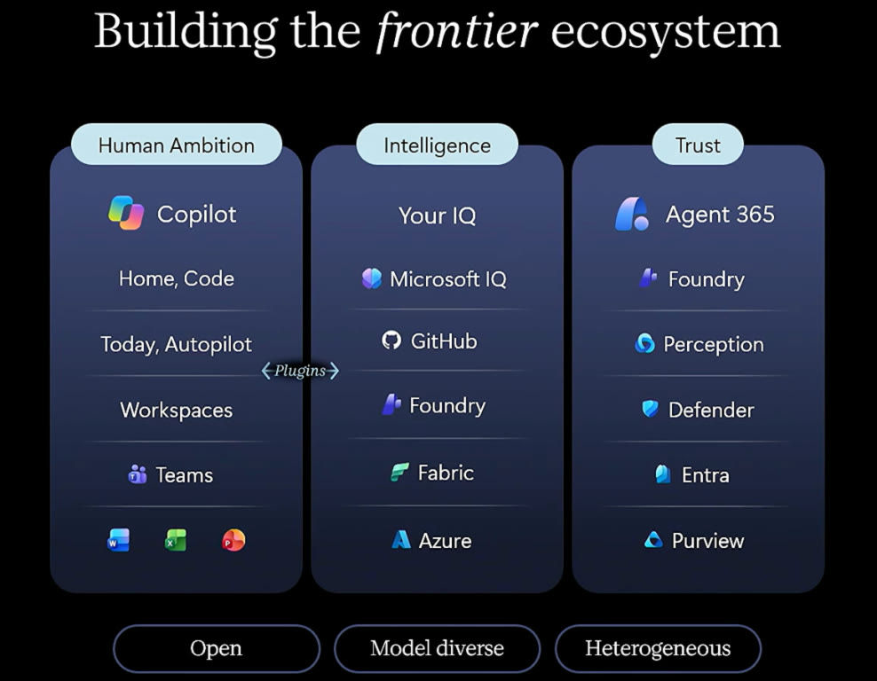

MICROSOFT IGNITE 2026 · SAN FRANCISCO · NOV 17–20

# Ignite 2026 Session Notes

2026년 11월 17–20일, 샌프란시스코에서 열린 Microsoft Ignite 2026.

[Microsoft Ignite](https://ignite.microsoft.com/en-US/home) 는 Microsoft 의 주요 발표와 깊이 있는 기술 학습, 다음 변화를 만드는 사람들을 직접 만나는 자리입니다.
키노트 · 기술 세션 · 핸즈온 랩 · 자격증 과정으로 agentic business applications, agent platform, cloud & AI platform, Copilot, data & AI platform, Frontier Transformation, security, Windows ecosystem 등을 다룹니다.

[세션 카탈로그](catalog/index.md){ .dg-button .dg-button--primary }
[작성된 노트](sessions/index.md){ .dg-button .dg-button--secondary }

<!-- gen:stats -->

<strong>934<small>/1,426</small></strong>online sessions

<strong>10</strong>session types

<strong>831</strong>on-demand videos

<strong>728</strong>transcripts

<strong>3<small>/0</small></strong>notes / done

<!-- /gen:stats -->

RECENT NOTES

## 최근 노트

<!-- gen:recent -->

<a class="dg-note-card dg-note-card--review" href="sessions/BRK256-video-ai-scale-microsoft-foundry-fal/"><code>BRK256</code>Breakout🔍 검토 중<strong>Video AI at scale with Microsoft Foundry and fal</strong>fal 이 서빙하는 영상 생성 모델 세 계열 — Kling Video v3 · MiniMax H3 · LTX-2.5 — 이 Microsoft Foundry 에 Public Preview 로 들어왔습니다. 세션의 메시지는 &quot;가장 좋은 모델 하나&quot; 가 아니라 품질은 Kling, 속도와 물량…Agent Platform</a>
<a class="dg-note-card dg-note-card--review" href="sessions/BRK251-agents-production-observe-evaluate-optimize-foundry/"><code>BRK251</code>Breakout🔍 검토 중<strong>Agents in production: Observe, evaluate, and optimize with Foundry</strong>에이전트는 오류 없이 &quot;돌아가면서도&quot; 틀린 답을 낼 수 있어서, 운영 관측의 질문이 &quot;Is it up?&quot; 에서 &quot;Is it right?&quot; 로 바뀌었다는 것이 세션의 출발점입니다. Foundry 는 이를 Build(평가 기준 세우기) → Production(모르던 문제 찾고 고치기) →…Agent Platform</a>
<a class="dg-note-card dg-note-card--review" href="sessions/KEY01-microsoft-ignite-opening-keynote/"><code>KEY01</code>Keynote🔍 검토 중<strong>Microsoft Ignite opening keynote</strong>Ignite 2026 오프닝 키노트는 Human Ambition · Intelligence · Trust 세 가지 의제로 짜여 있었습니다. Satya Nadella 는 이를 AI 시대의 세 가지 &quot;architectural imperative&quot; 로, Judson Althoff 는 fron…Security · Frontier Transformation · Agent Platform</a>

<!-- /gen:recent -->

BROWSE BY TOPIC

## 토픽으로 둘러보기

온라인으로 볼 수 있는 세션을 카탈로그 토픽별로 모았습니다. 카드를 누르면 그 토픽으로 걸러진 카탈로그가 열립니다.

<!-- gen:topics -->

<a class="dg-topic-card" href="catalog/?topic=Cloud%20%26%20AI"><strong>Cloud &amp; AI</strong>192<small> sessions</small>▶ 175 · 📝 노트 1</a>
<a class="dg-topic-card" href="catalog/?topic=Agent%20Platform"><strong>Agent Platform</strong>136<small> sessions</small>▶ 118 · 📝 노트 3</a>
<a class="dg-topic-card" href="catalog/?topic=Security"><strong>Security</strong>116<small> sessions</small>▶ 100 · 📝 노트 1</a>
<a class="dg-topic-card" href="catalog/?topic=Copilot"><strong>Copilot</strong>92<small> sessions</small>▶ 81 · 📝 노트 1</a>
<a class="dg-topic-card" href="catalog/?topic=Agentic%20Business%20Applications"><strong>Agentic Business Applications</strong>87<small> sessions</small>▶ 80 · 📝 노트 0</a>
<a class="dg-topic-card" href="catalog/?topic=Data"><strong>Data</strong>75<small> sessions</small>▶ 67 · 📝 노트 0</a>
<a class="dg-topic-card" href="catalog/?topic=Frontier%20Transformation"><strong>Frontier Transformation</strong>71<small> sessions</small>▶ 65 · 📝 노트 1</a>
<a class="dg-topic-card" href="catalog/?topic=Windows"><strong>Windows</strong>56<small> sessions</small>▶ 47 · 📝 노트 0</a>
<a class="dg-topic-card" href="catalog/?topic=Microsoft%20IQ"><strong>Microsoft IQ</strong>44<small> sessions</small>▶ 36 · 📝 노트 1</a>
<a class="dg-topic-card" href="catalog/?topic=Other"><strong>Other</strong>35<small> sessions</small>▶ 34 · 📝 노트 0</a>
<a class="dg-topic-card" href="catalog/?topic=MAICPP"><strong>MAICPP</strong>32<small> sessions</small>▶ 27 · 📝 노트 0</a>

<!-- /gen:topics -->

