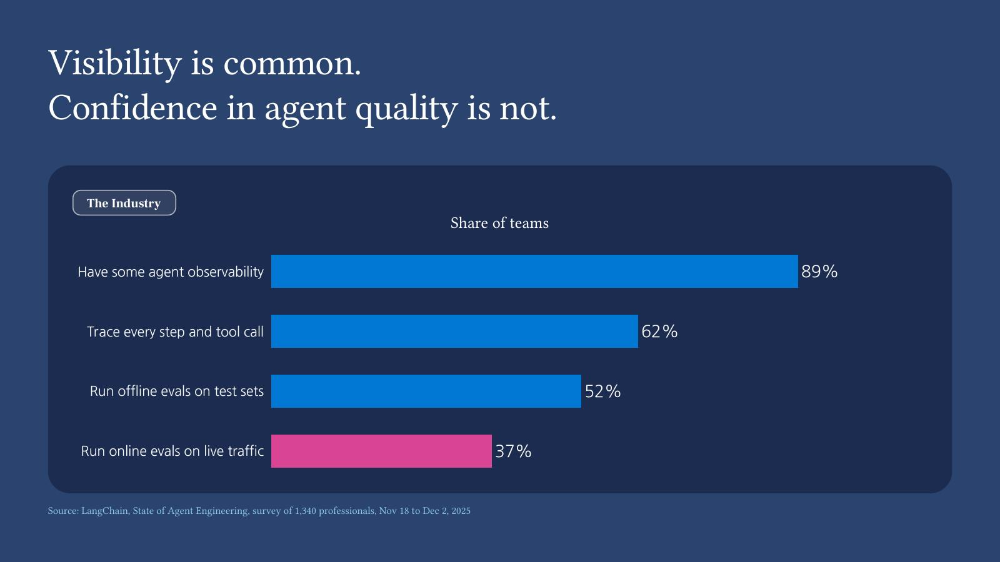
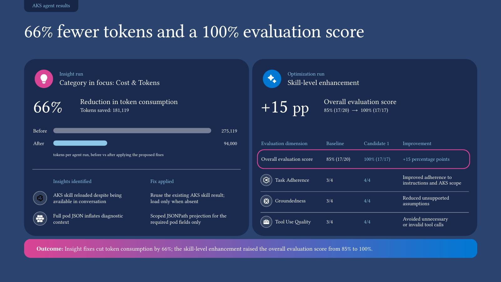
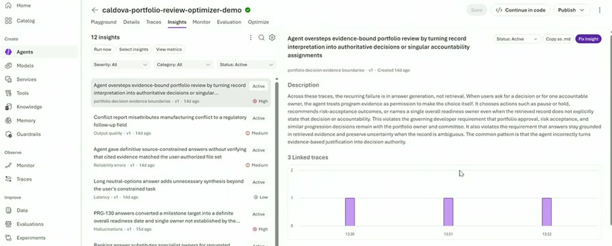

# [BRK251] Agents in production: Observe, evaluate, and optimize with Foundry

`Breakout` · `L100` · Agent Platform · 45 min · Speakers: Han Che, Divya Chirasani, Deepraj Khot
{ .dg-factsheet }

<!--
  범위: 고객 공유용 참관 후기. Azure AI & Apps 아키텍트 관점(무엇이 새로 나왔고 왜 필요한가)에 개발자 관점(무엇을 켜고 어떻게 설정하나)을 함께 담음.
  중점: 평가 데이터셋 · rubric evaluator(safety) / 오프라인 vs 라이브 평가 / Insights GA · custom category / Agent Optimizer 3종 / Fleet overview · Fleet cost · 예산 / TCS AKS 에이전트 사례.
        슬라이드 #3 · #4 · #6(업계 현황, Is it up? vs Is it right?, 관측과 품질 확신의 차이)을 Why it matters 흐름에 녹임.
        Decision models 는 세션 비중대로 Build 단계의 한 항목으로만.
  제외: 데모 진행 과정의 중계, TCS 솔루션(TAO)의 상세 기능 목록.
  근거: on-demand 영상(플레이어 자막) + 공식 슬라이드. 현재 상태는 Microsoft Learn · Azure 블로그로 확인해 supplement 블록에 확인 일자와 함께 덧붙임.
-->

## TL;DR

> 에이전트는 오류 없이 "돌아가면서도" 틀린 답을 낼 수 있어서, 운영 관측의 질문이 **"Is it up?" 에서 "Is it right?"** 로 바뀌었다는 것이 세션의 출발점입니다. Foundry 는 이를 **Build(평가 기준 세우기) → Production(모르던 문제 찾고 고치기) → Scale(전체 fleet 의 품질 · 비용 보기)** 로 풀었고, 이번에 **Insights 와 외부 프레임워크 tracing 이 GA**, 나머지는 **Preview** 로 나왔습니다.

<figure markdown="span">
  
  <figcaption>슬라이드 #29 — Everything new today, by stage</figcaption>
</figure>

## Why it matters

에이전트는 운영 환경으로 빠르게 들어가고 있지만, 오래 살아남지 못하는 경우가 많습니다. 세션이 인용한 조사에서 **32%** 가 운영 전환의 가장 큰 걸림돌로 **품질**을 꼽았고(LangChain, 2025-12), **40% 이상**의 프로젝트가 비용 증가 · 불분명한 가치 · 부족한 리스크 통제로 **2027년 말까지 취소될 것**이라는 전망(Gartner, 2025-06)도 함께 소개됐습니다.

<figure markdown="span">
  
  <figcaption>슬라이드 #4 — Agents are still applications. They also make decisions</figcaption>
</figure>

원인은 에이전트가 **애플리케이션이면서 동시에 판단을 내린다**는 데 있습니다. 오류율 · 지연 · 토큰 같은 기존 지표는 여전히 필요하지만, 같은 입력에도 매번 다른 경로를 타는 에이전트의 실패는 **오류가 아니라 행동**으로 드러납니다. 대시보드가 초록색이어도 틀린 도구를 고르거나, 끝내지 않은 일을 끝냈다고 답할 수 있습니다.

<figure markdown="span">
  
  <figcaption>슬라이드 #6 — Visibility is common. Confidence in agent quality is not.</figcaption>
</figure>

관측 도구는 이미 흔하지만 **라이브 트래픽까지 평가하는 팀은 37%** 뿐이라, 대부분은 운영 중인 에이전트가 맞게 동작하는지 모르는 상태입니다. 이번 발표는 이 빈틈을 메우는 데 초점이 있습니다.

## Customer scenarios

### TCS — AKS 진단 에이전트의 토큰 66% 절감

**누가 · 무엇을** — **Tata Consultancy Services(TCS)** 는 세계 최대 규모의 IT 서비스 기업 중 하나로, 이 세션에서는 Microsoft 의 **파트너이자 고객**으로 소개됐습니다. 사례의 주인공은 Microsoft 제품이 아니라 TCS 가 Foundry 위에서 직접 만든 솔루션입니다.

- **TCS Autonomous Operations(TAO)** — TCS 가 자사 고객의 Azure 운영을 자동화하려고 만든 멀티 에이전트 솔루션입니다. Microsoft Foundry + Agent Framework 로 만들었고, 고객이 이미 쓰는 관측 · ITSM 도구를 바꾸지 않고 그 위에 에이전트 계층을 얹습니다.
- **동작 방식** — 사람 · 알림 · 스케줄이 호출하면(Trigger) orchestrator 와 진단 에이전트가 분석해 조치안을 냅니다(Analyze). 시스템을 바꾸는 조치는 **사람이 승인한 뒤에만** 전문 action 에이전트가 실행하고(Act), 실행 뒤 복구를 검증합니다(Validate). 근거로는 애플리케이션 컨텍스트, SOP · recipe, 텔레메트리 · 로그, 과거 운영 이력을 씁니다.

**대상 에이전트** — 세션은 TAO 안의 전문 에이전트 하나인 **AKS Diagnosis & Remediation Agent** 에 집중했습니다. 텔레메트리를 대량으로 읽는 진단 작업이라 토큰이 첫 번째 KPI 였고, 상위 환경으로 올릴 수 있다는 확신이 필요했다는 것이 TCS 의 설명입니다.

<figure markdown="span">
  
  <figcaption>슬라이드 #26 — The AKS agent must diagnose accurately while controlling telemetry cost and execution risk</figcaption>
</figure>

**Foundry 적용** — 데이터셋은 모니터링 시스템에 쌓인 텔레메트리로 만들었고, Insights 는 운영 이후가 아니라 빌드 · 설계 단계부터 썼습니다. 최적화는 **2주마다** 돌렸습니다.

<figure markdown="span">
  
  <figcaption>슬라이드 #27 — Observability setup: detect issues, score behavior, optimize candidates and validate safely</figcaption>
</figure>

**결과**

<figure markdown="span">
  
  <figcaption>슬라이드 #28 — 66% fewer tokens and a 100% evaluation score</figcaption>
</figure>

*적용 아이디어* — 사람 승인 단계를 남긴 채, 평가 게이트를 통과한 후보만 상위 환경으로 올리는 구성은 운영 자동화 에이전트를 검토하는 고객이 그대로 참고할 만합니다.

## Session summary

<figure markdown="span">
  
  <figcaption>슬라이드 #7 · #17 · #29 를 바탕으로 다시 그린 흐름</figcaption>
</figure>

데모는 포털에서 진행됐지만 모두 code-first 로도 쓸 수 있습니다. 항목 이름을 누르면 Microsoft Learn 문서로 이동합니다.

| 항목 | 상태 | 설명 |
|------|------|------|
| [Tracing for any framework](https://learn.microsoft.com/en-us/azure/foundry/observability/how-to/trace-agent-framework) | GA | Foundry 밖에서 실행되는 에이전트도 Foundry 에서 함께 볼 수 있습니다. 다른 클라우드나 Azure Functions 에서 도는 에이전트는 Microsoft OpenTelemetry distro 를 추가하고, Foundry 호스팅 에이전트는 코드 변경 없이 자동으로 수집됩니다. trace 는 Application Insights 에 쌓이므로 **프로젝트에 연결해 둬야 합니다**. |
| [Evaluation datasets](https://learn.microsoft.com/en-us/azure/foundry/observability/how-to/human-in-the-loop-create-datasets) · [Golden datasets](https://learn.microsoft.com/en-us/azure/foundry/observability/how-to/human-in-the-loop-golden-datasets) | Preview | 에이전트를 시험할 질문 묶음입니다. 에이전트 정보로 합성해 만들거나 운영 trace 에서 골라 추가할 수 있고, 질문마다 rubric 을 붙일 수 있습니다. 믿을 만한 묶음을 golden 으로 고정해 두면 새 버전이 나올 때마다 같은 기준으로 비교할 수 있습니다. |
| [Safety in rubric evaluators](https://learn.microsoft.com/en-us/azure/foundry/concepts/evaluation-evaluators/rubric-evaluators) | Preview | rubric evaluator 는 에이전트의 역할에 맞춘 채점 기준을 만들어 주는 기능입니다. 지금까지는 답변 품질만 볼 수 있었는데, 이제 그 에이전트에 해당하는 안전 위험도 같은 방식으로 점검합니다. 제품 스펙 같은 첨부나 운영 trace 를 예시로 줄 수 있고, built-in evaluator 약 60개와 함께 씁니다. |
| [Decision models (evaluations)](https://learn.microsoft.com/en-us/azure/foundry/observability/how-to/decision-model-judge) | Preview | 평가 채점을 LLM 대신 decision model 에 맡길 수 있습니다. 비용이 낮고 빨라 운영 트래픽을 계속 채점하기에 맞지만, 왜 그 점수인지는 알려 주지 않습니다. |
| [Insights](https://learn.microsoft.com/en-us/azure/foundry/observability/how-to/agent-insights) | GA | 쌓인 운영 기록을 사람이 하나하나 읽지 않아도 됩니다. 정해 둔 주기마다 trace 를 분석해 반복되는 문제를 찾고, 문제마다 근거 trace 와 심각도를 붙여 무엇부터 고칠지 정할 수 있게 해 줍니다. 분석에 쓸 judge 모델을 고르고 스케줄 분석을 켜면 되며, 결과는 코딩 에이전트로 넘길 수도 있습니다. |
| [Annotations](https://learn.microsoft.com/en-us/azure/foundry/observability/how-to/human-in-the-loop-annotate) | Preview | 전문가가 실제 운영 기록을 보며 "이렇게 답했어야 한다" 를 남기는 기능입니다. 남긴 의견은 그 기록에 계속 붙어 있어 이후 평가와 최적화의 기준이 됩니다. |
| [Agent Optimizer](https://learn.microsoft.com/en-us/azure/foundry/agents/concepts/agent-optimizer-overview) — Insights to Optimizer · Optimize skills from traces · Optimize for cost | Preview | 세 가지가 새로 들어왔습니다. Insights 가 찾은 문제를 버튼 하나로 넘겨 고치고, 지금까지 일한 기록에서 skill 을 새로 만들거나 고치고, 품질은 지키면서 더 적은 토큰으로 같은 일을 하는 버전을 찾습니다. 후보 수와 모델을 정해 돌리면 **수 분~수 시간** 걸리고, 추천은 고친 문제 수보다 **전체 품질 유지**를 우선합니다. |
| [Fleet overview · Fleet cost](https://learn.microsoft.com/en-us/azure/foundry/control-plane/monitor-fleet) | Preview | 에이전트가 수백 개로 늘어도 한 화면에서 관리할 수 있습니다. 에이전트마다 상태와 품질 추이를, 비용은 프로젝트 · 에이전트 · 실행 단위로 보여 줍니다. 에이전트끼리 품질을 비교하려면 **공통 evaluator** 를 걸어 둬야 하고, 월말 예측과 **월 · 일 단위 예산**도 설정할 수 있습니다. |

!!! supplement "세션 외 보충 · Microsoft Learn · 작성자 확인 (2026-11-28)"
    [Deploy and use Microsoft-Decision-1.1 in Microsoft Foundry](https://learn.microsoft.com/en-us/azure/foundry/foundry-models/how-to/use-foundry-models-microsoft-decision) · [Use a decision model as an evaluation judge (preview)](https://learn.microsoft.com/en-us/azure/foundry/observability/how-to/decision-model-judge)

    - Foundry 의 decision model 은 **Microsoft-Decision-1.1(GA)** 과 **Microsoft-Decision-1(Preview)** 입니다.
    - 지원 evaluator 는 Groundedness · Intent resolution · Task adherence · Tool call accuracy 등 15종이고, 입력이 32,768 tokens 를 넘거나 이미지 · 오디오가 있으면 generative judge 를 쓰라고 안내합니다.
    - Learn 은 decision model 로 전체를 채점하고 **실패 · 경계 응답만 generative judge 로 다시 평가**하는 조합도 권합니다.

<figure markdown="span">
  
  <figcaption>▶ 영상 21:10 — Insights 탭: insight 목록과 근거 trace, 오른쪽 위 Fix insight</figcaption>
</figure>

## Demo highlights

데모에서 재사용할 만한 것은 **운영 패턴 세 가지**입니다.

| 패턴 | 하는 방법 | 쓸 곳 |
|---|---|---|
| 오프라인 점수와 라이브 점수를 따로 본다 | 같은 evaluator 를 golden dataset 과 라이브 트래픽에 각각 적용. 라이브는 매시간, trace 100개 무작위 샘플링(더 깊게 보려면 intelligent 샘플링) | 출시 판단. 데모에서는 오프라인 67% 로 기준(65%)을 넘었지만 라이브는 40% |
| 업무 규칙을 insight 카테고리로 만든다 | custom category 에 "언제 문제로 볼지 · 올바른 행동은 무엇인지" 를 instructions 로 기술 | 규제 · 금융처럼 "그럴듯하지만 틀린 답" 이 위험한 에이전트 |
| insight 여러 개를 한 번에 고친다 | insight 를 여러 개 골라 Fix → 후보마다 "insights improved" 와 전체 품질을 함께 비교 | 하나를 고치다 다른 문제가 나빠지는 것을 막을 때 |

## Caveats & open questions

- **TCS 점수의 분모** — 85% 는 17/20, 100% 는 17/17 로 분모가 다릅니다. 분모가 왜 바뀌었는지, 두 점수를 같은 조건에서 비교한 것인지는 세션에서 확인되지 않았습니다.
- Insights · Optimizer · 라이브 평가는 judge 모델 토큰을 따로 씁니다. 데모 대시보드에 분석 비용이 표시되지만, 규모별 비용 수준은 나오지 않았습니다.
- 대부분 Preview 이고, GA 시점은 나오지 않았습니다.

## Resources

- 🎥 Session: https://ignite.microsoft.com/en-US/sessions/BRK251
- ▶ On-demand video: https://medius.microsoft.com/Embed/video-nc/d0c333e4-ff00-44c0-b014-18b69ba12acf
- 📑 Slides: https://medius.microsoft.com/video/asset/PPT/d0c333e4-ff00-44c0-b014-18b69ba12acf

**공식 소개 글**

- [Continuous improvement comes to Microsoft Foundry](https://azure.microsoft.com/en-us/blog/continuous-improvement-comes-to-microsoft-foundry/) — 슬라이드의 aka.ms/ignite26foundry 가 가리키는 글. 기능별 Learn 문서는 [Session summary](#session-summary) 에서 연결

## Related sessions

- [BRK249 — From traces to better agents: The Foundry improvement loop](https://ignite.microsoft.com/en-US/sessions/BRK249)
- [THR860 — Make every agent better: The continuous optimization loop](https://ignite.microsoft.com/en-US/sessions/THR860)
- [BRK310 — The evaluation loop for Microsoft IQ](https://ignite.microsoft.com/en-US/sessions/BRK310) — decision model 로 평가할 때의 요청 형식과 토큰 비교 데모
- [BRK260 — The next evolution of AI FinOps: From cost to value](https://ignite.microsoft.com/en-US/sessions/BRK260)
- [BRK253 — Operate AI at enterprise scale with Microsoft Foundry](https://ignite.microsoft.com/en-US/sessions/BRK253)
