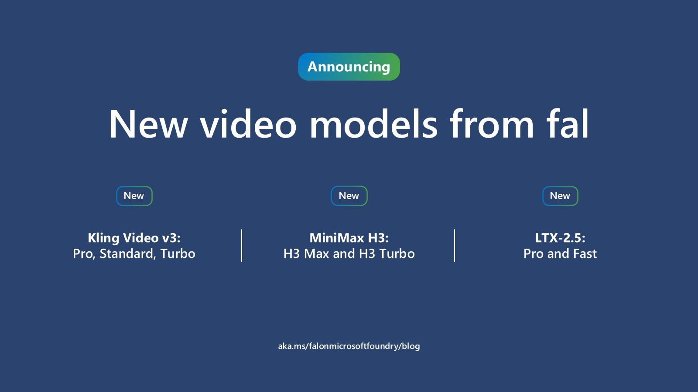
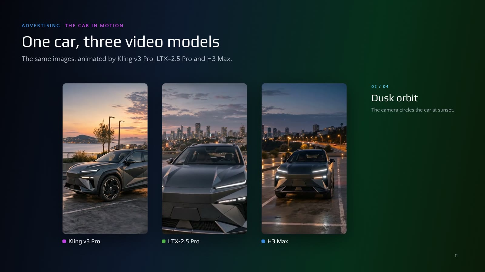
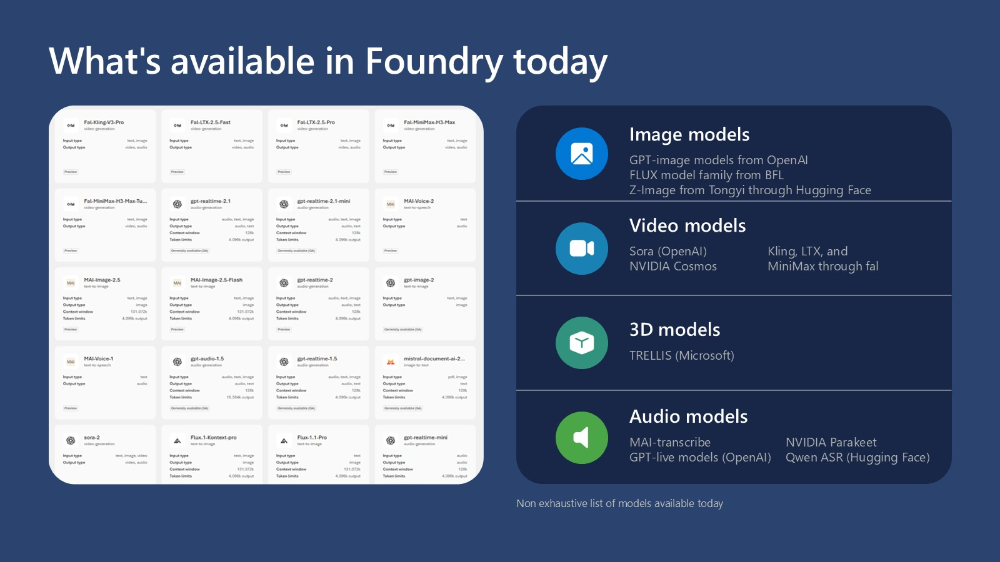
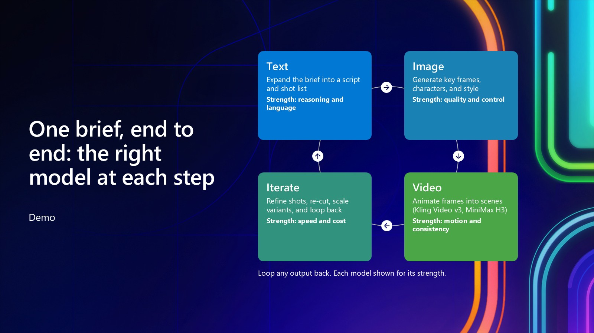
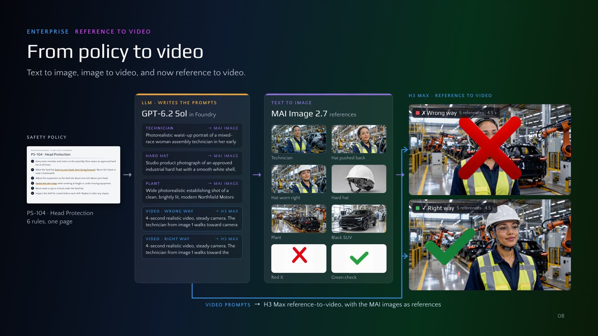

# [BRK256] Video AI at scale with Microsoft Foundry and fal

`Breakout` · `L300` · Agent Platform · 45 min · Speakers: Alexander Hughes, Naomi Moneypenny, Burkay Gur, Lovis Odin Odin
{ .dg-factsheet }

세션 내용을 옮긴 기록이 아니라, Foundry 에서 영상 생성을 검토할 때 필요한 것만 추려 현재 제공 상태와 함께 정리한 노트입니다.

<!--
  범위: Azure AI & Apps 아키텍트 관점의 검토 노트. Sora 2 종료로 비어 있던 Foundry 의 영상 생성 자리에 fal 모델이 고려할 만한 선택지로 들어왔다는 것이 핵심 —
        ① Foundry 에서 영상 생성을 무엇으로 하나 ② Kling · MiniMax H3 · LTX-2.5 는 무엇이 다른가 ③ 어느 리전에서, 어떤 조건으로 쓸 수 있나(한국 포함).
  제외: 발표 순서대로의 요약(Session summary), 발표자가 무엇을 말했는지의 중계, fal 회사 소개, 데모 진행 과정, 영상 생성과 무관한 고객 사례의 세부.
  구성: 결론(TL;DR) → 모델 비교 · 선택 기준(Top highlights) → Foundry 영상 생성의 선택지 · 가용 리전(Why it matters) → 발표 상태 → 조합 구조와 패턴(Architecture · Demo highlights).
  근거: 공식 트랜스크립트(기여자가 직접 연 파일) + on-demand 영상(플레이어 자막) + 슬라이드. 현재 제공 상태는 Microsoft Learn · 공식 블로그 · 작성자 조회 결과로 확인해 supplement 블록에 확인 일자와 함께 가볍게 덧붙임.
-->

## TL;DR

> fal 이 서빙하는 영상 생성 모델 세 계열 — **Kling Video v3 · MiniMax H3 · LTX-2.5** — 이 Microsoft Foundry 에 Public Preview 로 들어왔습니다. 세션의 메시지는 "가장 좋은 모델 하나" 가 아니라 **품질은 Kling, 속도와 물량은 MiniMax H3, 제어는 LTX** 로 용도를 나눠 고르라는 것입니다.

<figure markdown="span">
  
  <figcaption>슬라이드 #11 — New video models from fal</figcaption>
</figure>

!!! supplement "세션 외 보충 · 이 발표의 의미 (Microsoft Learn · 작성자 확인, 2026-11-28)"
    Foundry 에서 바로 배포해 쓰는 콘텐츠 제작용 영상 생성 모델은 `sora-2` 가 2026-11-02 에 종료된 뒤로 **fal 의 5종뿐**입니다. Foundry 에서 영상 생성을 하려는 팀에게 다시 고려해 볼 선택지가 생겼다는 것이 이 발표의 의미입니다. → [근거](#foundry-video-options)

    **한국 리전(Korea Central)에서는 배포할 수 없습니다.** → [가용 리전](#availability)

## Top highlights

### 1. 세 계열 한눈에 {#model-comparison}

<figure markdown="span">
  
  <figcaption>슬라이드 #30 (삽입 영상 11.2초) — One car, three video models</figcaption>
</figure>

| fal 의 설명 | Kling Video v3 | MiniMax H3 | LTX-2.5 |
|---|---|---|---|
| 한 줄 요약 | 전문가급 품질, 비용이 높은 편 | 품질은 Kling 에 근접, 훨씬 빠름 | 품질보다 제어(controllability) |
| 공개 여부 | closed source | open source | open model |
| 변형 | Pro · Standard · Turbo | H3 Max · H3 Turbo | Pro · Fast |
| 잘하는 것 | cinematic shot, 폭발 같은 VFX, 물리 · 일관성 | 말하는 사람 · 표정, 음성 생성, 장면 전환 | 레이어별 정의, 모션 지정, 3D 모델 입력 |
| 속도 | 세 모델 중 느린 편 | Kling 과 견주어 "like 20 times faster", 2~3초 생성 | 수치 없음 |
| 비용 감각 | 초당 "tens of cents" | H3 Turbo 는 초당 "less than a cent" | 미언급 |
| 이럴 때 고른다 | 완성도가 중요한 최종본 | 대량 · 저지연, 개인화, 빠른 반복 | 기존 제작 파이프라인의 한 단계 |
| 주의점 | 비용 | 미언급 | 프롬프트 한 줄 결과물에는 부적합 |

fal 의 설명을 모은 표이고, 속도 · 비용 수치는 조건 없이 든 어림값입니다.

!!! supplement "세션 외 보충 · 현재 Foundry · Microsoft Learn 에서 확인했을 때 (2026-11-28)"
    [Fal models on Microsoft Foundry (preview)](https://learn.microsoft.com/en-us/azure/foundry/how-to/fal-ai-models/enable-fal-models) · [Building the next generation of multimodal AI experiences with fal in Microsoft Foundry](https://techcommunity.microsoft.com/blog/azure-ai-foundry-blog/building-the-next-generation-of-multimodal-ai-experiences-with-fal-in-microsoft-/4570032) (2026-11-05)

    - 지금 배포할 수 있는 것은 **5종**입니다. Kling 은 v3 Pro 가 올라와 있고, H3 Turbo 는 "MiniMax H3 Max Turbo" 라는 이름입니다. 가격은 아래 표와 같습니다.
    - LTX 의 레이어 · 3D 입력, 파인튜닝, content filter 적용은 Learn 의 fal 문서에는 나와 있지 않습니다.
    - fal 은 입력 프롬프트를 자동으로 보강합니다. Learn 의 MiniMax 예제에 `"prompt_expansion_mode": "disabled"` 파라미터가 있어, 이를 끄는 설정으로 보입니다.

    | 모델 | 입력 방식 | 배포 유형 | 해상도 | 길이(초) | 가격(USD / 영상 1초) |
    |---|---|---|---|---|---|
    | Kling v3 Pro | text-to-video, image-to-video | US Data Zone | API 스키마에 명시 없음 | 3~15 | $0.1232 (audio off) · $0.1848 (audio on) · $0.2156 (audio + voice control) |
    | LTX-2.5 Fast | text-to-video, image-to-video | Global Standard | 720p · 1080p · 1440p · 2160p | 6~20 (20초까지는 720p · 1080p 의 24 · 25 FPS 만, 그 밖은 10초까지) | $0.09 (720p) · $0.13 (1080p) · $0.19 (1440p) · $0.30 (4K) |
    | LTX-2.5 Pro | text-to-video, image-to-video | Global Standard | 720p · 1080p | 6 · 8 · 10 | $0.12 (720p) · $0.17 (1080p) |
    | MiniMax H3 Max | text-to-video, image-to-video, reference-to-video | Global Standard | 480P · 768P · 1080P | 0.92~15 | $0.05 (480p) · $0.08 (768p) · $0.16 (1080p) |
    | MiniMax H3 Max Turbo | text-to-video, image-to-video | Global Standard | 480P · 768P · 1080P | 0.92~15 | $0.025 (480p) · $0.04 (768p) · $0.08 (1080p) |

    오디오는 Kling v3 Pro(native audio generation)와 LTX 두 변형(synchronized video and audio)이 지원하고, reference-to-video 는 이미지 · 영상 · 오디오를 합쳐 최대 12개 파일까지 참조로 받습니다.

### 2. 고르는 기준

- **벤치마크 대신 직접 비교** — 영상은 LLM 과 달리 믿을 만한 벤치마크가 없고 취향이 크게 작용합니다. 같은 프롬프트를 전부 돌려 나란히 보는 것이 fal 의 권고("try all")입니다.
- **open 모델은 손볼 수 있다** — MiniMax H3 · LTX 는 기능 추가(keyframe, 참조 방식)와 자체 IP(캐릭터) 학습의 대상이 된다는 것이 fal 의 설명입니다. H3 의 속도도 fal 이 모델을 직접 최적화한 결과입니다.

## Why it matters

- Foundry 가 모델만이 아니라 **inference provider 를 고르는 곳**으로 넓어집니다. 이번 fal 모델이 그 시작이고, 더 늘어날 예정입니다.
- 영상 생성에서도 **호스팅 위치가 선택 기준**이 됐습니다. 프롬프트 · 참조 이미지 · IP 가 그대로 민감 데이터이기 때문입니다.

### Foundry 의 영상 생성 선택지 {#foundry-video-options}

<figure markdown="span">
  
  <figcaption>슬라이드 #3 — What's available in Foundry today</figcaption>
</figure>

!!! supplement "세션 외 보충 · Microsoft Learn · 작성자 확인 (Azure CLI 조회, 2026-11-28)"
    [Retired Microsoft Foundry Models](https://learn.microsoft.com/en-us/azure/foundry/openai/concepts/retired-models) · [Video generation with Sora 2 (preview)](https://learn.microsoft.com/en-us/azure/foundry/openai/concepts/video-generation) · [nvidia--cosmos3-nano 모델 카드](https://ai.azure.com/catalog/models/nvidia--cosmos3-nano)

    | 확인한 것 | 결과 | 출처 |
    |---|---|---|
    | Sora 2 | `sora-2` 버전 2025-12-08 의 retirement date 는 November 2, 2026. suggested replacement 는 비어 있음 | Learn |
    | Foundry 에 남은 영상 생성 모델 | 영상 생성 기능이 표시된 모델은 `sora-2`(Deprecated)와 **fal 5종뿐** | 작성자 조회 (East US 2 · Sweden Central · West US 3 · East US) |
    | NVIDIA Cosmos | 영상도 생성하는 omnimodal world model. 용도는 world simulation · Physical AI 로, 콘텐츠 제작용과 성격이 다름 | 모델 카드 |
    | Sora 2 와 다른 점 | 호출 경로 · 스키마가 다른 별도 API 라 새 배포와 코드 수정이 필요. Sora 2 의 **Remix**(생성한 영상의 부분 수정)에 해당하는 기능은 없음 | Learn |

    **판단 (적용 아이디어)**

    - **고려해 볼 만합니다** — text · image → video 와 오디오 생성까지 Sora 2 와 범위가 겹칩니다.
    - **Sora 2 보다 나은지는 확인하지 않았습니다** — 품질을 직접 비교한 자료는 세션에도 문서에도 없습니다. 조회도 작성자 구독 기준입니다.

### 가용 리전 · 사용 조건 {#availability}

!!! supplement "세션 외 보충 · Microsoft Learn · 작성자 확인 (Azure CLI 조회, 2026-11-28)"
    [Fal models on Microsoft Foundry (preview)](https://learn.microsoft.com/en-us/azure/foundry/how-to/fal-ai-models/enable-fal-models) · [Deploy and use Claude models in Microsoft Foundry](https://learn.microsoft.com/en-us/azure/foundry/foundry-models/how-to/use-foundry-models-claude)

    **한국 리전(Korea Central)을 포함한 아시아 리전에는 없습니다.** 해외 리전에 Foundry 리소스를 따로 만들어야 합니다.

    | 항목 | 결과 | 출처 |
    |---|---|---|
    | 가용 리전 | **East US 2**(5종), **Sweden Central**(Kling v3 Pro 제외 4종). 조회한 나머지 리전에는 없음 | 작성자 조회 (32개 리전) |
    | 한국 계약 | fal 문서에 국가 · 구독 유형 제외 목록 없음. Claude 문서는 "Enterprise Accounts located in South Korea" 를 미지원으로 명시. 한국 EA 구독에서의 실제 배포는 미확인 | Learn |
    | 데이터 처리 | fal 서비스는 "operated outside of Microsoft facilities". Microsoft 의 Product Terms · DPA · certifications 미적용, fal Terms of Service 적용 | Learn |
    | 시작 조건 | 구독 Owner 또는 Contributor 가 `Fal.EnableDeploy` preview feature 를 1회 등록 | Learn |
    | 쿼터 | 분당 요청 수 free tier 0, Tier 1~4 는 2, Tier 5~7 은 40 | Learn |
    | 모델 수명 | 버전 2026-11-02, lifecycle Preview, 추론 종료 예정일 2027-02-17 | 작성자 조회 |

    **판단 (적용 아이디어)** — 한국 계약을 막는 문서상 제한은 없지만, 한국 EA 구독에서 실제로 배포되는지부터 확인해야 합니다. 배포가 되더라도 프롬프트 · 참조 이미지 · 결과 영상이 국외에서 fal 약관으로 처리되므로, 인물 사진이나 미공개 제품 이미지를 넣는 경우와 금융 · 공공 고객은 법무 · 보안 검토가 먼저입니다.

## Customer scenarios

영상 생성을 실제 서비스에 쓰는 사례는 둘입니다. 둘 다 fal 이전의 사례이지만, 어디에 쓰는지를 보여 줍니다.

- **HyperCinema** — 방문객의 얼굴 스캔과 성격 퀴즈로 개인화 이미지와 30~45초 영상을 5분 안에 제공. 사례 공개 당시 하루 이미지 50,000장, 영상 6,000개.
- **WPP** — 피칭 단계에서 스토리보드 대신 애니메이션 영상으로 캠페인을 미리 보여 줌. 브랜드 가이드라인으로 프롬프트를 만들어 레시피 · 언어 · 플랫폼별로 일괄 생성. Sora 를 쓴 사례입니다.

## Key announcements

| 항목 | 상태 | 근거 | 비고 |
|------|------|------|------|
| fal on Microsoft Foundry | Public Preview | 슬라이드 #10 "Available Now as Public Preview" | fal 카탈로그의 영상 모델을 Foundry Models 에서 "first-party Azure service" 로 제공 |
| Kling Video v3 | Public Preview | 슬라이드 #10 · #11 "New" | closed source. 슬라이드에 소개된 변형은 Pro · Standard · Turbo |
| MiniMax H3 | Public Preview | 슬라이드 #10 · #11 "New" | open source, fal 의 post-training · 속도 최적화 적용. 슬라이드에 소개된 변형은 H3 Max · H3 Turbo |
| LTX-2.5 | Public Preview | 슬라이드 #10 · #11 "New" | open model, 제어 중심. 슬라이드에 소개된 변형은 Pro · Fast |

상태는 계열 단위의 발표 기준입니다. 변형마다 지금 배포할 수 있는지는 [현재 확인한 목록](#model-comparison)을 보세요.

## Architecture

<figure markdown="span">
  
  <figcaption>슬라이드 #17 — One brief, end to end: the right model at each step</figcaption>
</figure>

- 영상 모델 하나로 끝내지 않고 **LLM → 이미지 모델 → 영상 모델 → 반복**의 체인으로 짭니다.
- 영상의 출발점은 대개 이미지입니다. 인물 · 제품 · 배경을 이미지로 먼저 고정한 뒤 움직이게 만들어야 일관성이 유지됩니다.

## Demo highlights

데모에서 가져갈 것은 **조합 패턴 세 가지**입니다. 쓰인 모델은 모두 Foundry 에 있습니다.

| 패턴 | 모델 조합 | 쓸 곳 | 영상 |
|---|---|---|---|
| 이미지 편집 → 영상 | MAI Image 2.7 → LTX-2.5 Pro 또는 H3 Max | 인물 · 제품 컷을 고친 뒤 그대로 움직이는 영상으로 | 34:40 |
| 문서 → 영상 | GPT-6.2 Sol → MAI Image 2.7 → H3 Max (reference-to-video) | 한 쪽짜리 안전 수칙을 "잘못된 예 / 올바른 예" 교육 영상으로 자동 변환 | 37:30 |
| 이미지 한 장 → 캠페인 | MAI Image 2.7 → Kling v3 Pro · LTX-2.5 Pro · H3 Max | 광고 이미지 하나에서 영상, 규격별 · 언어별(한국어 포함) 변형까지 | 39:00 |

<figure markdown="span">
  
  <figcaption>슬라이드 #25 (삽입 영상 17.2초) — From policy to video</figcaption>
</figure>

재사용할 만한 것은 **문서 → 영상** 패턴입니다. 교육 자료가 많을 때 흐름 전체를 Foundry API 로 자동화할 수 있습니다.

## Caveats & open questions

- 생성 속도와 품질은 직접 재 보지 않았습니다. 도입 전에 실제 프롬프트로 측정해야 합니다.
- GA 시점과 추가될 모델은 확인되지 않았습니다.

## Resources

- 🎥 Session: https://ignite.microsoft.com/en-US/sessions/BRK256
- ▶ On-demand video: https://medius.microsoft.com/Embed/video-nc/cd099c8b-eee0-43e9-a94b-470e9b9c52df
- 📑 Slides: https://medius.microsoft.com/video/asset/PPT/cd099c8b-eee0-43e9-a94b-470e9b9c52df

**공식 소개 글 · 문서**

- fal on Microsoft Foundry — [Building the next generation of multimodal AI experiences with fal in Microsoft Foundry](https://techcommunity.microsoft.com/blog/azure-ai-foundry-blog/building-the-next-generation-of-multimodal-ai-experiences-with-fal-in-microsoft-/4570032) (슬라이드의 aka.ms/falonmicrosoftfoundry/blog 가 가리키는 글)
- 단계별 모델 선택과 비동기 API 예제 — [Build a multi-model video generation workflow with fal on Microsoft Foundry](https://techcommunity.microsoft.com/blog/azure-ai-foundry-blog/build-a-multi-model-video-generation-workflow-with-fal-on-microsoft-foundry/4573786) (2026-11-25)
- 사용 방법 · 모델별 제약 — [Fal models on Microsoft Foundry (preview)](https://learn.microsoft.com/en-us/azure/foundry/how-to/fal-ai-models/enable-fal-models)
- Sora 2 종료 일정 — [Retired Microsoft Foundry Models](https://learn.microsoft.com/en-us/azure/foundry/openai/concepts/retired-models)

