# [KEY01] Microsoft Ignite opening keynote

`Keynote` · Security · Frontier Transformation · Agent Platform · Cloud & AI · Microsoft IQ · Copilot · 120 min · Speakers: Satya Nadella, Judson Althoff
{ .dg-factsheet }

<!--
  범위: Azure AI & Apps 관점 참관 후기. M365 Copilot · Copilot Workspaces · Copilotforce 등 M365 발표는 제외.
  구성: 핵심 의제(TL;DR) → 제품 소개(Top highlights) → 고객·현장 사례(Customer scenarios) → GA/Preview 정리(Key announcements).
  근거: 공식 트랜스크립트 + on-demand 영상. 세션 밖 정보(공식 블로그)는 supplement 블록에만.
-->

## TL;DR

> Ignite 2026 오프닝 키노트는 **Human Ambition · Intelligence · Trust** 세 가지 의제로 짜여 있었습니다. Satya Nadella 는 이를 AI 시대의 세 가지 "architectural imperative" 로, Judson Althoff 는 frontier transformation 의 세 가지 "durable asset" 으로 소개했습니다. Azure 관점에서 보면 **Intelligence** 기둥에는 Decision 1.1 GA, Foundry 의 지속 개선 루프, 에이전트 규모에 맞춰 다시 짠 GitHub·Azure 인프라, HorizonDB GA 가, **Trust** 기둥에는 Perception GA 와 Agent 365 비용 통제가 놓였습니다.

<figure markdown="span">
  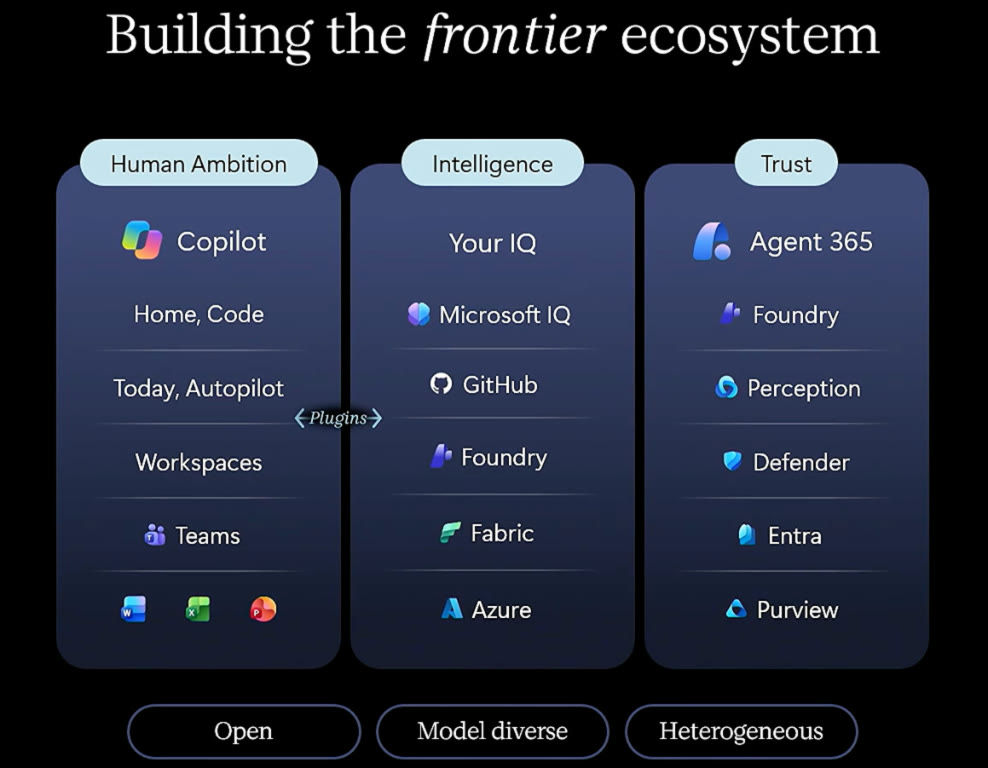
  <figcaption>▶ 영상 2:21:45 — Building the frontier ecosystem</figcaption>
</figure>

- **Human Ambition** — AI 는 사람을 대체하는 것이 아니라 의도·판단·전문성을 증폭하는 도구입니다. 개발자가 코드를 쓰는 사람에서 "소프트웨어를 만드는 공장(software factory)을 만드는 사람" 으로 바뀌어도 판단과 craft 는 여전히 사람의 몫이라는 것이 Satya 의 설명입니다. Judson 은 "Infinite cognitive compute will never replace human purpose." 로 키노트를 닫았습니다.
- **Intelligence** — "Not artificial, yours." 모든 회사가 같은 frontier 모델을 쓸 수 있는 시대에 차이를 만드는 것은 **조직 고유의 데이터·프로세스·암묵지(IQ)** 이고, 그것이 모델 회사가 아니라 **고객 안에 쌓여야 한다**는 메시지입니다. GitHub · Foundry · Fabric · Azure 가 이 기둥에 있습니다.
- **Trust** — Satya 는 "alignment 도, 모델의 내부 동작도 아직 완전히 이해되지 않는다" 며 **intelligence 의 공급과 그에 대한 권한(authority)을 분리하는 것**이 아키텍처 요건이라고 했습니다. Judson 의 표현으로는 "The only way to gain trust is through observability." Agent 365 · Foundry · Perception · Defender · Entra · Purview 가 이 기둥입니다.
- 세 기둥 아래의 **Open · Model diverse · Heterogeneous** — 특정 모델·플랫폼에 묶이지 않는다는 원칙은 이후 제품 소개마다 반복됐습니다.

## Top highlights

키노트에서 소개된 제품을 **Intelligence → Trust** 순서로 정리했습니다. 고객·현장 사례는 아래 [Customer scenarios](#customer-scenarios) 에 따로 모았습니다.

### Intelligence ① Microsoft Decision 1.1 — "판단" 만 전문으로 하는 모델

<figure markdown="span">
  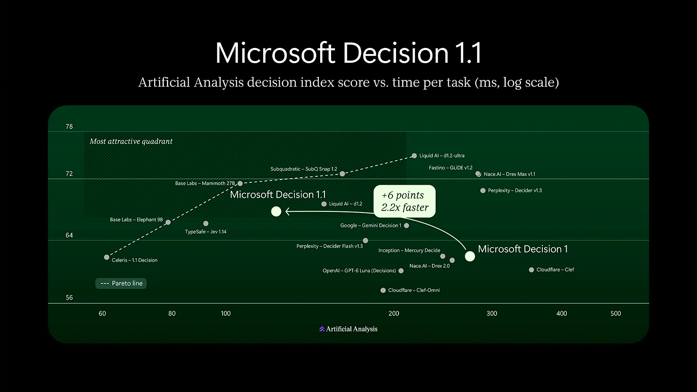
  <figcaption>▶ 영상 17:36 — Microsoft Decision 1.1</figcaption>
</figure>

!!! ga "GA"
    **Microsoft Decision 1.1** — "now generally available and ready for enterprise deployment."

Satya 는 "relational databases 가 software engineering 을 바꿨듯 **decision engineering** 이 소프트웨어를 바꿀 것" 이라며 **Decision Models** 를 소개했습니다. 라우팅·분류·우선순위·검증처럼 소프트웨어 안의 **분기 판단만** 내리는 모델로, 지능을 소프트웨어의 core primitive 로 심기 위한 부품입니다.

- **10x 빠르고 200x 저렴**: "more than 10x faster and 200 times less expensive than using an LLM."
- 1.1 에서 **multimodal 입력 지원**, 정확도·응답 속도 개선. 이미 **4,000+ 고객**이 사용 중입니다.
- Microsoft 안에서는 **Copilot 이 사용자 요청을 어떤 mode·model·effort 로 보낼지** 이 모델로 결정하고, Xbox 는 게임 출시 피드백 수만 건을 주제별로 분류하는 데 씁니다. Epic 은 환자 경험·임상·백오피스 앱 전반의 판단에 사용합니다.
- **의미**: 에이전트 아키텍처에서 "어느 모델로 보낼까 · 이 요청은 어디로 · 사람이 봐야 하나" 같은 판단을 frontier LLM 에 맡기던 부분을 **작고 빠른 전용 모델로 떼어 내** 비용과 지연을 줄일 수 있습니다.

!!! supplement "세션 외 보충 · Microsoft Command Line 블로그 (2026-11-17)"
    [Microsoft-Decision-1.1 is now generally available for fast, low-cost decision making](https://commandline.microsoft.com/microsoft-decision-model-ga/)

    - Microsoft Foundry, OpenRouter, Vercel 에서 사용 가능.
    - 개발자가 정한 **허용된 action 안에서만** 고르고 **calibrated confidence** 를 돌려주며, 정보가 부족하면 **abstain** — 앱이 임계값을 정해 "실행 / 플래그 / 사람에게 escalate" 를 나눌 수 있습니다.
    - Copilot ↔ Cowork 라우팅을 LLM 과 같은 정확도로 2.2x 빠르게, 4.4x 낮은 비용으로 처리. **Foundry Evaluations 의 judge** 로도 사용 가능.
    - 가격(Foundry input): Global Standard $0.042 / 1M tokens, US Data Zone $0.046, EU·APAC Data Zone $0.05. **Output tokens 무료**.

### Intelligence ② Microsoft Foundry — 모델을 고르는 곳에서 "계속 좋아지는" 곳으로

Jay Parikh 는 에이전트 플랫폼을 이렇게 정리했습니다: **"GitHub is where you build, Fabric is where your data is organized, and Foundry is where your agents run in production and keep getting better."** 에이전트를 만드는 것은 쉽지만 identity·sandboxing·데이터 접근·모니터링·red teaming 까지 갖춰 **수천 개를 운영하고 계속 개선하는 것**이 어렵다는 문제의식입니다.

- **모델 선택**: OpenAI · Anthropic · Meta · Mistral · open-weight · MAI 를 포함한 **11,000+ 모델**을 한곳에서 평가하고, 더 나은 모델이 나오면 에이전트를 다시 만들지 않고 교체합니다. 이번에 **GPT-6.2 series(GPT-6.2 Astra · GPT-6.2 Sol)** 가 Foundry 에 들어왔고, Meta 의 최신 모델도 Foundry 로 옵니다.
- **model router**: 단순한 요청은 작고 빠른 모델로, 복잡한 요청은 frontier 모델로 — 전부 frontier 로 보낼 때보다 **up to 65% 저렴**.
- **managed agent harness**: "The same harness we use to power Copilot and GitHub Copilot is now available to you." 장기 실행 에이전트를 배포하는 런타임입니다.
- **지속 개선 루프**: ① 트레이스와 사용자 입력을 다시 시스템으로 → ② Foundry 가 모든 run 을 보고 개선안을 찾아 품질·속도·비용 트레이드오프와 함께 제시, **배포 여부는 사람이 결정** → ③ skill 개선부터 agent 설정, **자체 데이터로 모델 학습**까지. 직접 정의한 private benchmark·eval 로 측정하고, "all of this learned intelligence stays with you."
- **MAI 모델**: 비용 대비 성능에 집중한 Microsoft 자체 모델. 이번에 **Code 2 / Code 2 Flash**(agentic coding), **Cyber 2 Flash**(보안), **Image 2.7 / Image 2.7 Flash** 를 소개했고, **MAI Licensed Weights** 로 MAI 모델을 자사 데이터로 커스터마이즈해 **고객의 Azure 환경에서** 직접 운영하는 길도 열었습니다.
- **의미**: 모델은 계속 바뀌니 "어떤 모델이 최고인가" 보다 **우리 기준(eval)으로 측정하고 개선하는 루프**를 갖추는 것이 핵심 자산이 된다는 것 — 이 루프가 실제로 어떻게 돌아가는지는 아래 [Alaska Airlines 사례](#alaska-airlines-foundry-eval) 가 보여 줍니다.

!!! ga "GA"
    **GPT-6.2 series in Foundry** (GPT-6.2 Astra · GPT-6.2 Sol) — 키노트 슬라이드에 "General availability" 로 표시.

!!! preview "Public Preview"
    **MAI Image 2.7 · Image 2.7 Flash** — 키노트 슬라이드에 "Public preview" 로 표시.

상태 미언급: managed agent harness, model router · 개선 루프의 신규 기능, Code 2 / Code 2 Flash / Cyber 2 Flash, MAI Licensed Weights, Meta 모델.

!!! supplement "세션 외 보충 · Microsoft Foundry Blog (2026-11-17)"
    [From model choice to your durable advantage: Build AI that keeps improving](https://techcommunity.microsoft.com/blog/azure-ai-foundry-blog/from-model-choice-to-your-durable-advantage-build-ai-that-keeps-improving/4573609) 에 나온 상태:

    - **MAI-Code-2 / MAI-Code-2-Flash**: GitHub 에서 사용 가능, Foundry 의 Code-2-Flash 는 **limited access preview**. **MAI-Cyber-2-Flash** 는 Codename MDASH 를 통해 제공 예정.
    - **MAI-Image-2.7 / 2.7-Flash**: Foundry 에서 **public preview**. Meta Muse Wonder · Muse Spark 1.3 · Muse Ember 는 **coming soon**.
    - **model router**: 지원 프로젝트에서 자동 모델 선택이 기본값, 44개 모델에서 선택, AI Gateway 에서도 사용 가능.
    - **학습**: Managed Training(이전 managed fine-tuning, SFT·RFT), Python 으로 학습 레시피를 직접 쓰는 **Programmed Training public preview**. **Managed Compute GA**, Baseten on Foundry public preview.

### Intelligence ③ "GitHub is the home for agents" — 에이전트 규모로 다시 짠 GitHub 과 Azure

<figure markdown="span">
  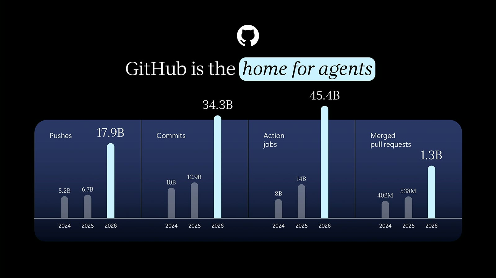
  <figcaption>▶ 영상 30:15 — GitHub is the home for agents</figcaption>
</figure>

인프라 이야기의 출발점은 GitHub 이었습니다. Push·commit·Actions·PR 이 모두 에이전트에 의해 폭증하고 있습니다.

| 지표 | 2024 | 2025 | 2026 |
|---|---|---|---|
| Pushes | 5.2B | 6.7B | **17.9B** |
| Commits | 10B | 12.9B | **34.3B** |
| Action jobs | 8B | 14B | **45.4B** |
| Merged pull requests | 402M | 538M | **1.3B** |

- 그래서 GitHub 은 **Git 아키텍처부터 코어를 다시 짰습니다** — storage·compute 분리, push 의 critical path 최소화. 테스트에서 **에이전트 5,000개가 한 repo 에 초당 7,200 writes**, 현재 처리량의 **180x** 를 유지했습니다.
- 그리고 "what worked for GitHub now needs to be pervasive throughout the Azure platform" — 이것이 **Azure agent primitives** 입니다.

<figure markdown="span">
  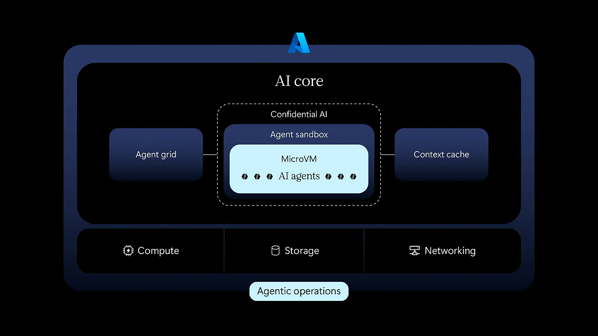
  <figcaption>▶ 영상 33:45 — Azure AI core</figcaption>
</figure>

- **MicroVM**: 1초 미만으로 뜨는 full sandbox isolation, **confidential computing enclave** 안에서 실행 가능.
- **Agent grid**: identity·policy-aware 네트워킹 — 에이전트마다 무엇에 접근하고, 어디에 연결하고, **어떤 에이전트와 통신할 수 있는지**까지 제어.
- **Context cache**: 모델 로딩 가속.
- 이 모두를 **AKS · AKS Flex · Foundry hosted agents** 로 감싸 에이전트 애플리케이션의 기반으로 제공합니다.
- **의미**: 에이전트 트래픽은 사람 트래픽과 규모·패턴이 다르다는 것을 GitHub 수치가 보여 주고, Azure 는 그 답으로 **에이전트 단위의 격리·네트워크 정책·캐시**를 인프라 레벨에 넣고 있습니다. 상태·출시 일정은 키노트에서 언급되지 않았습니다.

!!! supplement "세션 외 보충 · Apps on Azure Blog (2026-11-17)"
    [Run models and agents on your own Kubernetes clusters: AKS at Microsoft Ignite 2026](https://techcommunity.microsoft.com/blog/appsonazureblog/run-models-and-agents-on-your-own-kubernetes-clusters-aks-at-microsoft-ignite-20/4573912) — Foundry hosted agents 를 고객 AKS 클러스터에서 실행하는 **AKS AI Manager for Foundry**, Kata microVM 격리 또는 ACI 기반 serverless 런타임을 고르는 **Agent Sandbox extension** 등 세부 내용.

### Intelligence ④ HorizonDB — 에이전트를 위한 PostgreSQL, 그리고 Fabric

<figure markdown="span">
  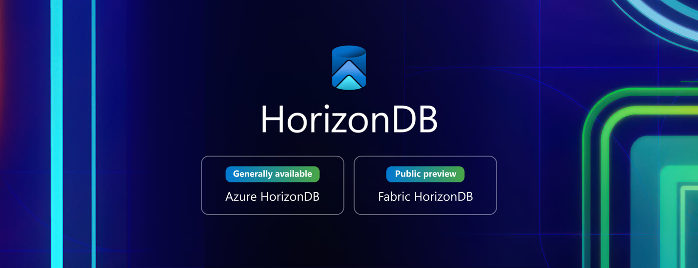
  <figcaption>📰 공식 블로그 · [HorizonDB: PostgreSQL for enterprises, developers, and agents on Azure and Fabric](https://techcommunity.microsoft.com/blog/adforpostgresql/horizondb-postgresql-for-enterprises-developers-and-agents-on-azure-and-fabric/4573498) (2026-11-17)</figcaption>
</figure>

!!! ga "GA"
    **Azure HorizonDB** — "HorizonDB is generally available in Azure."

!!! preview "Public Preview"
    **Fabric HorizonDB** — 키노트 슬라이드에 "Public preview" 로 표시.

"Agents need databases that can keep up with their speed and scale" — 데이터 레이어에서 나온 답이 **HorizonDB** 입니다.

- 분산 managed PostgreSQL 로, ultra-low latency · scalable reads · **built-in Search** · AI 기능을 갖췄고 self-managed Postgres 대비 **8x 빠른 성능**입니다.
- **HorizonDB 를 Fabric 으로**: Satya 가 "25년 동안 해 온 일" 이라고 표현한 **트랜잭션과 분석의 완전한 통합**입니다. 실시간 주문·재고 변경과 페타바이트급 이력을 에이전트가 함께 추론하고, Copilot 에 "지금 우리 비즈니스에 무슨 일이?" 라고 물으면 실시간 대시보드를 만들어 줍니다.
- **Fabric HorizonDB** 는 serverless 로, 수 초 안에 프로비저닝됩니다.
- **의미**: 벡터 DB · 검색 · RDB 를 따로 붙이던 RAG/에이전트 백엔드를 PostgreSQL 하나로 모으고, serverless Fabric HorizonDB 로 **에이전트가 직접 DB 를 만들고 버리는 패턴**까지 겨냥합니다.

!!! supplement "세션 외 보충 · Microsoft Blog for PostgreSQL (2026-11-17)"
    [HorizonDB: PostgreSQL for enterprises, developers, and agents on Azure and Fabric](https://techcommunity.microsoft.com/blog/adforpostgresql/horizondb-postgresql-for-enterprises-developers-and-agents-on-azure-and-fabric/4573498)

    - Azure HorizonDB 는 **13개 Azure region** 에서 GA. 최대 128 TB, 기본 AZ 간 복원력, sub-millisecond commit latency, 5초 미만 failover, Entra ID · Private endpoint · Customer-managed keys.
    - **8x 의 조건**: HammerDB TPROC-C(95K warehouses, 512 users), Edsv6 64 vCores, PostgreSQL 17.11, Korea Central 에서 HA 구성의 self-managed PostgreSQL 과 비교한 내부 벤치마크.
    - 에이전트용 기능: pgvector 호환 + DiskANN, BM25, RRF 하이브리드 검색, Apache AGE 그래프, AI Functions · AI Pipelines, **PostgreSQL MCP Server · PostgreSQL Skills**.
    - Fabric HorizonDB: 5분 비활성 시 compute 자동 pause, OneLake 기본 mirroring, Fabric Data Warehouse 로 넘겨 실행하는 translytical query.

### Trust ① Perception — agentic security system

<figure markdown="span">
  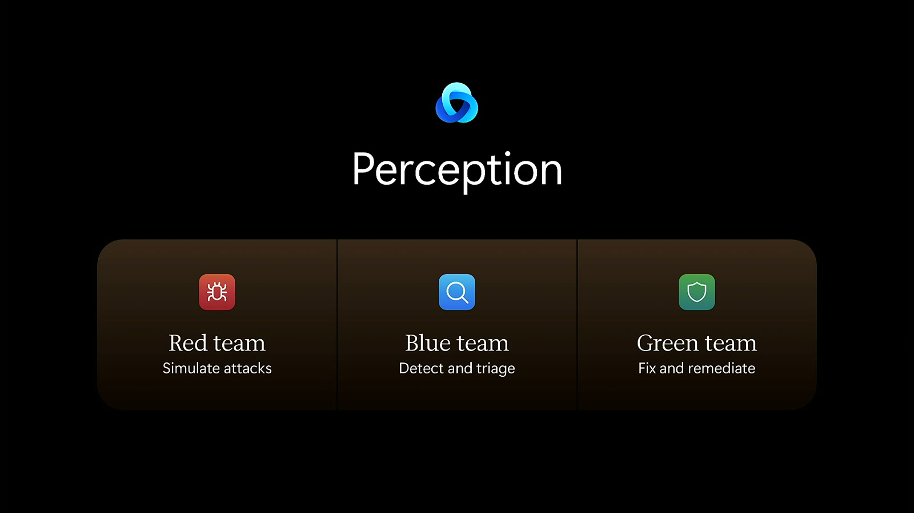
  <figcaption>▶ 영상 25:45 — Perception</figcaption>
</figure>

!!! ga "GA"
    **Perception** — "Perception is now generally available."

공격이 agentic·autonomous 해지는 만큼 방어도 **machine speed 의 agentic response** 가 필요하다는 것이 출발점입니다. Aleš Holeček 은 그 배경을 세 가지로 설명했습니다 — 이번 달 Patch Tuesday 취약점이 **1,000개 이상**(3월에는 100개 미만), 약 $300,000 급 바운티 취약점을 AI 로 **$5 미만**에 찾는 비용 붕괴, 발견에서 악용까지의 시간이 0 에 수렴.

- **Red team** 에이전트는 공격을 시뮬레이션하고(예: 웹앱의 auth·API·injection·비즈니스 로직까지 보는 Pen Test 에이전트), **Blue team** 은 탐지·조사, **Green team** 은 posture·코드·detection 을 고칩니다.
- 이들을 **playbook** 으로 묶어 트리거 기반으로 자율 실행하고, 비용·소요 시간을 미리 보여 주며, human-in-the-loop 가 필요한 작업은 kanban 으로 관리합니다. 실행 비용과 결과는 FinOps 대시보드와 Agent 365 로 이어집니다.
- 기반은 Defender · Entra · Purview · Sentinel 이 센서·actuator 로 동작하는 스택과 **500+ 보안 커넥터**, 하루 **165조 시그널**입니다. 작업마다 적합한 모델로 라우팅하며, 여기에 **MAI Cyber 2 Flash** 가 들어갑니다(CyberGym end-to-end 에서 GPT-6 Astra 를 앞서고 task 당 비용은 2% 미만).
- **의미**: 보안 운영이 "알림을 사람이 하나씩 처리" 에서 "**에이전트 팀이 먼저 처리하고 사람이 승인**" 으로 넘어갑니다. 실제로 자율 공격이 방어된 환경에서 어떻게 막혔는지는 아래 [ARTEX 사례](#artex-defender) 에 정리했습니다.

!!! supplement "세션 외 보충 · Microsoft Perception Blog (2026-11-17)"
    [What's new with Microsoft Perception at Ignite 2026](https://techcommunity.microsoft.com/blog/perception-blog/whats-new-with-microsoft-perception-at-ignite-2026/4571834) — Project Perception 이 Microsoft Perception 으로 GA. Triage Agent 가 일반적인 Defender 큐 알림의 약 80% 를 triage, Okta·Salesforce·AWS 서드파티 시그널 지원, Web App Pen Test Agent 의 독립 벤치마크 결과 등.

### Trust ② Agent 365 — 에이전트의 control plane, 이제 FinOps 까지

<figure markdown="span">
  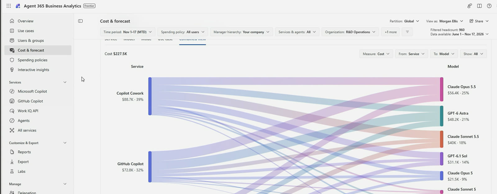
  <figcaption>▶ 영상 1:57:25 — Agent 365 Business Analytics</figcaption>
</figure>

!!! preview "Public Preview"
    **Agent 365 Business Analytics** — "available today, starting in **Frontier Public Preview**." Delegated spending policies 와 non-Microsoft agent cost visibility 는 **12월** 예정.

Agent 365 는 기존 governance · identity · security · management 를 에이전트로 확장하는 **control plane** 입니다. Microsoft 에이전트뿐 아니라 AWS · GCP · OpenAI · Anthropic 등 비 Microsoft 플랫폼과 Databricks · Snowflake · Salesforce 같은 데이터·앱 백엔드까지 하나의 registry 로 관리하며, 이미 **5천만 개 에이전트**를 관리 중입니다.

- **비용 통제**: 에이전트·부서·개인 단위로 한도와 알림을 걸고, IT 와 현업 리더가 각자 범위에서 예산을 관리합니다. Microsoft 에이전트는 **hard limit** 로 한도에서 사용을 바로 멈출 수 있습니다.
- **비용 spike 추적**: 에이전트별로 비용이 갑자기 오르면, 그것이 사용량 증가 때문인지 **모델 변경 때문인지** 구분하고, 모델을 되돌렸을 때의 forecast 와 비교해 조치합니다 (AT&T 사례 참고).
- **Agent 365 Business Analytics**: Satya 의 표현으로 "**an ERP system of AI usage**". 토큰이 아니라 **완료된 작업·절약 시간·만든 가치**를 측정하고, 서비스별 비용이 **어떤 모델로 흘러가는지**, use case 별 가치는 얼마인지 보여 줍니다. 저비용 모델 mix 로 forecast 를 돌려 보고, 예산을 **Azure subscription(코스트 센터)으로 chargeback** 하는 spending policy 까지 연결됩니다. Copilot Studio 뿐 아니라 **Amazon Bedrock** 에이전트 비용도 registry 에서 함께 봅니다.
- **보안**: 로컬 디바이스의 Shadow AI 탐지(65종 로컬 에이전트), 에이전트별 **dynamic agent risk**, Intune 연동 차단.
- **의미**: 에이전트가 수만 개가 되면 질문이 "몇 개 있나?" 에서 "**누가, 어떤 모델로, 얼마를 쓰고, 그만한 가치가 있나?**" 로 바뀝니다. 멀티 모델·멀티 플랫폼 환경의 AI FinOps 를 한 화면에서 보겠다는 것이 Agent 365 의 방향입니다.

!!! supplement "세션 외 보충 · Microsoft Tech Community (2026-11-17)"
    - [Introducing Microsoft Agent 365 Business Analytics: Turn AI investment into business value](https://techcommunity.microsoft.com/blog/ai-finops-blog/introducing-microsoft-agent-365-business-analytics-turn-ai-investment-into-busin/4574149) — Frontier 고객 대상 롤아웃, 라이선스 조건, 12월 기능.
    - [What's new in Microsoft Agent 365: Ignite 2026](https://techcommunity.microsoft.com/blog/agent-365-blog/whats-new-in-microsoft-agent-365-ignite-2026/4571753) — 에이전트 트레이스를 Azure Monitor · Application Insights 로 내보내는 Export Agent Activity 등.

## Customer scenarios

키노트 무대에서 보여 준 고객·현장 사례입니다. 위 제품이 실제로 어떻게 쓰이는지 보여 줍니다.

### Alaska Airlines — Foundry 로 eval → 최적화 → 학습 {#alaska-airlines-foundry-eval}

정비 리포트 텍스트를 보고 **ATA 코드**(항공 정비 분류 코드)를 추천하는 에이전트를 Foundry 안에서 개선한 사례입니다. 추천은 에이전트가, **최종 결정은 정비 엔지니어**가 합니다.

<figure markdown="span">
  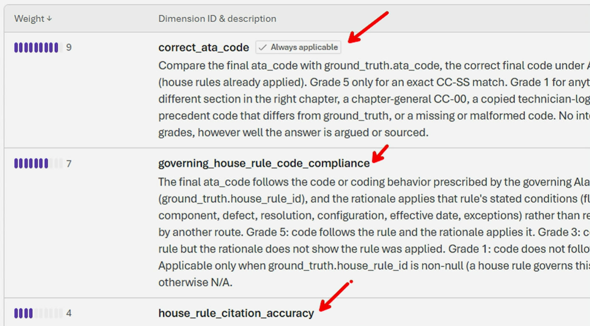
  <figcaption>▶ 영상 1:31:50 — Foundry 평가 rubric</figcaption>
</figure>

1. **"좋은 답" 을 먼저 정의 (Eval)** — Traces 로 실행 전체를 보고 rubric 으로 채점합니다. 정확한 ATA 코드뿐 아니라 **Alaska 사내 house rule 준수**와 인용 정확도까지 평가 기준에 들어갑니다. rubric 은 Foundry 가 만들고 사람이 검증했습니다.
2. **프롬프트 최적화 (Agent Optimizer)** — system prompt 와 tool description 을 반복 수정해 정확도를 올렸지만, instruction 이 길어지면서 **비용은 약 4배**로 늘었습니다.
3. **모델 학습 (RFT)** — "instruction 이 길다면 그것을 가중치로 옮길 때" 라는 판단으로 **MAI-Code-2-Flash 를 RFT** 로 학습했습니다.

<figure markdown="span">
  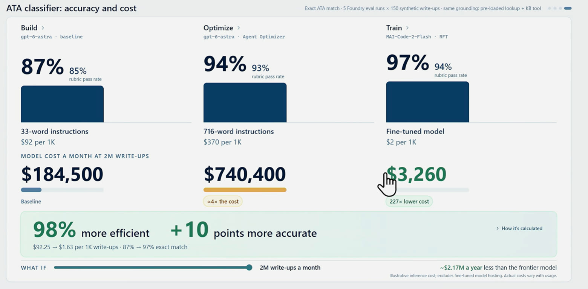
  <figcaption>▶ 영상 1:34:20 — ATA classifier: accuracy and cost</figcaption>
</figure>

| 단계 | 모델 / 방법 | 정확도 (exact ATA) | 1K 건당 비용 | 월 비용 (200만 건) |
|---|---|---|---|---|
| Build | gpt-6-astra · baseline | 87% | $92 | $184,500 |
| Optimize | gpt-6-astra · Agent Optimizer | 94% | $370 | $740,400 |
| Train | MAI-Code-2-Flash · RFT | **97%** | **$2** | **$3,260** |

- 결과: 정확도 **+10 points**, 비용 **98% 절감**. 단, 데모의 비용은 화면에 표시된 대로 예시 추론 비용(fine-tuned 모델 호스팅 제외)이고, 평가는 synthetic 정비 기록 150건 × 5 run 기준입니다.
- **가져갈 점**: 핵심은 "좋은 모델 고르기" 가 아니라 **우리 회사의 정답(rubric)을 먼저 만들고, 매 변경을 그 기준으로 자동 채점하는 것**입니다. *적용 아이디어*: 프롬프트·모델 변경마다 Foundry eval 을 돌리고, 품질·비용 기준을 통과한 후보만 사람이 승인해 배포하는 CI 형태의 파이프라인으로 구성하면 에이전트를 계속 개선되는 자산으로 운영할 수 있습니다.

### 보안 연구자의 ARTEX 테스트 — "방어된 네트워크에서는 블루팀이 이긴다" {#artex-defender}

<figure markdown="span">
  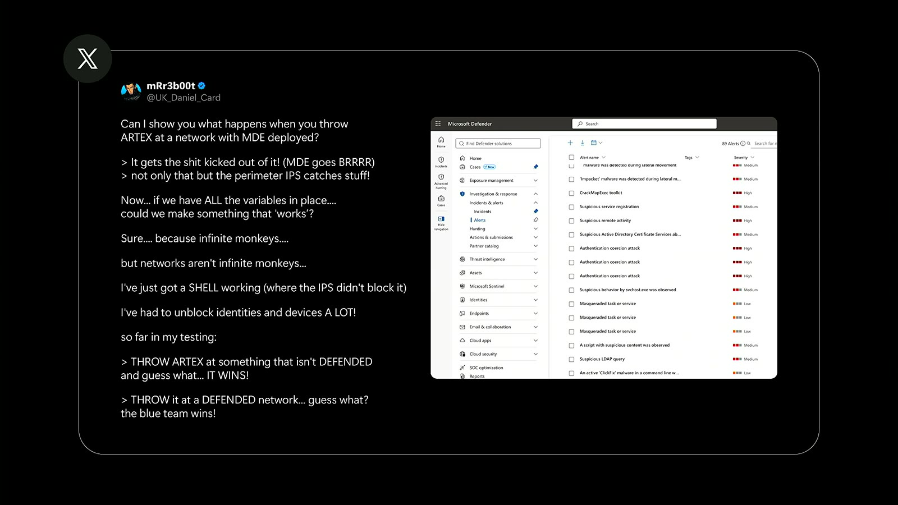
  <figcaption>▶ 영상 25:00 — ARTEX × Microsoft Defender 테스트 게시물</figcaption>
</figure>

Satya 가 Perception 을 소개하기 직전에 보여 준 사례입니다. 독립 보안 연구자가 요즘 화제인 **자율 AI 공격 프레임워크 ARTEX** 로 **Microsoft Defender 가 보호하는 환경**을 공격했습니다.

- 에이전트가 네트워크에서 계속 lateral movement 를 시도했지만 **Defender 의 automated attack disruption** 이 탈취된 계정을 격리하고 디바이스를 고립시키며 공격을 계속 막아 냈습니다.
- 연구자의 결론: 방어되지 않은 네트워크에서는 ARTEX 가 이기지만, "THROW it at a DEFENDED network... guess what? **the blue team wins!**" — 원문: [x.com/UK_Daniel_Card](https://x.com/UK_Daniel_Card/status/2119825084353233380) (2026-11-09).
- 다만 원문에는 IPS 가 놓친 지점에서 shell 을 한 번 얻었다는 내용도 함께 있습니다. "Defender 가 다 막는다" 보다는 **"방어 posture 가 갖춰진 환경에서는 자율 공격이 시끄럽고 잘 잡힌다"** 로 전달하는 것이 정확합니다.

!!! supplement "세션 외 보충 · Microsoft Security Blog (2026-11-06)"
    [ARTEX abuse expands as cybercriminals target financial sector](https://www.microsoft.com/en-us/security/blog/2026/11/06/artex-abuse-expands-as-cybercriminals-target-financial-sector/) — Microsoft Threat Intelligence 가 관찰한 ARTEX 악용 사례(금융 섹터 대상 Storm-3358), 탐지 신호, honeypot · tarpit · "fake win" 같은 대응 방법, Defender 탐지 목록과 hunting query.

### AT&T — 6만 개 에이전트의 비용·리스크 관리 (Agent 365)

AT&T 는 **60,000+ 에이전트**를 운영하며 Agent 365 로 관리합니다. Jeremy Legg(AT&T)의 말: "Forgotten agents can become rogue agents."

- 에이전트마다 Entra 의 고유 ID 가 있고, **agent map** 으로 도구·리소스·사람·모델과의 연결과 오류 지점을 봅니다.
- **Action center** 가 보안·권한·비용 이슈를 우선순위로 묶어 줍니다. 90일 미사용 에이전트는 소유자 알림 → 차단 → 삭제까지 **자동화**합니다.

<figure markdown="span">
  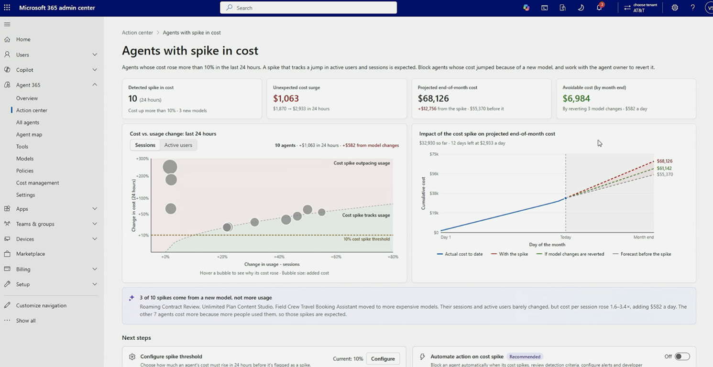
  <figcaption>▶ 영상 1:54:00 — Agents with spike in cost</figcaption>
</figure>

- **Agents with spike in cost**: 24시간 내 비용이 10% 넘게 오른 에이전트를 잡아냅니다. 데모에서는 spike 10건 중 **3건이 사용량이 아니라 더 비싼 모델로 바뀐 것**이 원인이었고, 세션당 비용이 1.6–3.4배로 올랐습니다. 모델을 되돌리면 월말까지 $6,984 를 아낄 수 있다는 forecast 와 함께 spending policy 로 임계값 알림을 겁니다.
- Jeremy Legg: CIO·CTO 가 CFO 에게 토큰 비용을 설명할 때 "you don't want to guess at those numbers."

## Key announcements

키노트에서 발표된 Azure AI & Apps 관련 항목을 상태별로 나눴습니다.

### GA

| 항목 | 근거 | 비고 |
|------|------|------|
| Microsoft Decision 1.1 | Satya Nadella "now generally available" | multimodal 지원, LLM 대비 10x 빠르고 200x 저렴 |
| GPT-6.2 series in Foundry (Astra · Sol) | 키노트 슬라이드 "General availability" | — |
| Azure HorizonDB | Satya Nadella "generally available in Azure" | self-managed Postgres 대비 8x |
| Perception | Satya Nadella "now generally available" | Red / Blue / Green team 에이전트 + playbook |
| Cobalt 200 VMs | Satya Nadella "general availability" | Azure 의 최고 성능 범용 VM. [Azure Blog](https://azure.microsoft.com/en-us/blog/azure-cobalt-200-vms-now-available-proven-on-real-workloads-and-built-for-the-agentic-era/) |

### Preview

| 항목 | 상태 | 근거 | 비고 |
|------|------|------|------|
| Fabric HorizonDB | Public Preview | 키노트 슬라이드 "Public preview" | serverless, 수 초 프로비저닝 |
| MAI Image 2.7 · Image 2.7 Flash | Public Preview | 키노트 슬라이드 "Public preview" | — |
| Agent 365 Business Analytics | Public Preview (Frontier) | Stephanie Cronin "starting in Frontier Public Preview" | delegated spending policies · non-Microsoft agent cost visibility 는 12월 |

### 발표됐지만 키노트에서 상태 미언급

| 항목 | 근거 | 비고 |
|------|------|------|
| MAI Code 2 · Code 2 Flash · Cyber 2 Flash | Satya Nadella, Mustafa Suleyman | Code 2: GPT 6.1 SOL 성능의 98% · 비용 40% (GitHub Copilot 의 일상 엔터프라이즈 코딩 과제 기준) |
| MAI Licensed Weights | Mustafa Suleyman | 고객 Azure 환경에서 실행, Frontier Company 통해 제공 |
| Meta 최신 모델 → Foundry | Satya Nadella "coming to Foundry" | — |
| Foundry managed agent harness · 지속 개선 루프 | Satya Nadella, Jay Parikh | Copilot · GitHub Copilot 과 같은 하네스 |
| Azure agent primitives (MicroVM · Agent grid · Context cache · AKS Flex · Foundry hosted agents) | Satya Nadella | 출시 형태·일정 언급 없음 |
| HorizonDB in Fabric (트랜잭션·분석 통합) | Satya Nadella | — |
| Maia 300 | Satya Nadella "We just announced" | leading GPU 시스템 대비 tokens per watt 40%+ |
| Agent 365 dynamic agent risk · Shadow AI 탐지 확대 | Yina Arenas | 로컬 에이전트 65종, Intune 연동 차단 |
| Microsoft AI Transparency Initiative | Satya Nadella | AI 투명성·보안·거버넌스 개방 표준, 40개 조직 참여. [Microsoft Source](https://news.microsoft.com/source/2026/11/17/microsoft-and-organizations-across-industries-launch-ai-transparency-initiative-to-strengthen-enterprise-trust-in-ai-models-and-agents/) |

## Caveats & open questions

- **상태 미언급 항목**은 위 표 그대로입니다. 일부는 공식 블로그에 상태가 나와 있어 각 제품의 보충 블록에 적었습니다(예: Code-2-Flash 는 Foundry 에서 limited access preview).
- **데모 수치는 데모 조건**: Alaska 사례의 비용은 예시 추론 비용이고 평가 데이터는 synthetic 입니다. Agent 365 화면의 비용·에이전트 수도 데모 값입니다. 고객에게는 구조를 보여 주고 숫자는 조건과 함께 전달하는 것이 안전합니다.
- **모델 이름**: Satya 가 언급한 "MAI Code Flash"(GitHub Copilot 3M users)와 "MAI Cyber"(Perception 스캔 40%+)는 키노트 슬라이드상 Code 1.1 Flash · Cyber 1.1 Flash 이고, 이번에 새로 발표된 것은 Code 2 / Code 2 Flash / Cyber 2 Flash 입니다.
- Agent 365 는 Microsoft 365 admin center 안의 제품이지만, 비 Microsoft 에이전트와 Azure subscription chargeback 을 다루기 때문에 이 노트에 포함했습니다.

## Resources

- 🎥 Session: https://ignite.microsoft.com/en-US/sessions/KEY01
- ▶ On-demand video: https://medius.microsoft.com/Embed/video-nc/03c19114-cb6e-42d3-9be3-f8b310426589
- 📄 Transcript: https://medius.microsoft.com/video/asset/Transcript/03c19114-cb6e-42d3-9be3-f8b310426589

**제품별 공식 소개 글**

- Decision 1.1 — [Microsoft-Decision-1.1 is now generally available for fast, low-cost decision making](https://commandline.microsoft.com/microsoft-decision-model-ga/)
- Foundry Models · MAI — [From model choice to your durable advantage: Build AI that keeps improving](https://techcommunity.microsoft.com/blog/azure-ai-foundry-blog/from-model-choice-to-your-durable-advantage-build-ai-that-keeps-improving/4573609) · [Microsoft AI 뉴스 · Ignite 2026](https://microsoft.ai/news/microsoft-ignite-2026/)
- AKS · agent sandbox — [Run models and agents on your own Kubernetes clusters: AKS at Microsoft Ignite 2026](https://techcommunity.microsoft.com/blog/appsonazureblog/run-models-and-agents-on-your-own-kubernetes-clusters-aks-at-microsoft-ignite-20/4573912)
- HorizonDB — [HorizonDB: PostgreSQL for enterprises, developers, and agents on Azure and Fabric](https://techcommunity.microsoft.com/blog/adforpostgresql/horizondb-postgresql-for-enterprises-developers-and-agents-on-azure-and-fabric/4573498)
- Cobalt 200 — [Azure Blog · Cobalt 200 VMs GA](https://azure.microsoft.com/en-us/blog/azure-cobalt-200-vms-now-available-proven-on-real-workloads-and-built-for-the-agentic-era/)
- Perception — [What's new with Microsoft Perception at Ignite 2026](https://techcommunity.microsoft.com/blog/perception-blog/whats-new-with-microsoft-perception-at-ignite-2026/4571834)
- ARTEX — [ARTEX abuse expands as cybercriminals target financial sector](https://www.microsoft.com/en-us/security/blog/2026/11/06/artex-abuse-expands-as-cybercriminals-target-financial-sector/)
- Agent 365 — [Introducing Microsoft Agent 365 Business Analytics](https://techcommunity.microsoft.com/blog/ai-finops-blog/introducing-microsoft-agent-365-business-analytics-turn-ai-investment-into-busin/4574149) · [What's new in Microsoft Agent 365: Ignite 2026](https://techcommunity.microsoft.com/blog/agent-365-blog/whats-new-in-microsoft-agent-365-ignite-2026/4571753)
- AI Transparency Initiative — [Microsoft Source 발표](https://news.microsoft.com/source/2026/11/17/microsoft-and-organizations-across-industries-launch-ai-transparency-initiative-to-strengthen-enterprise-trust-in-ai-models-and-agents/)
